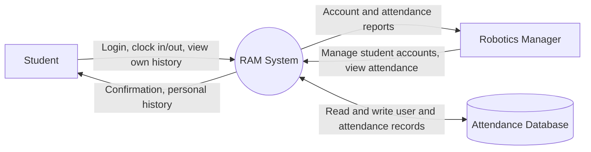
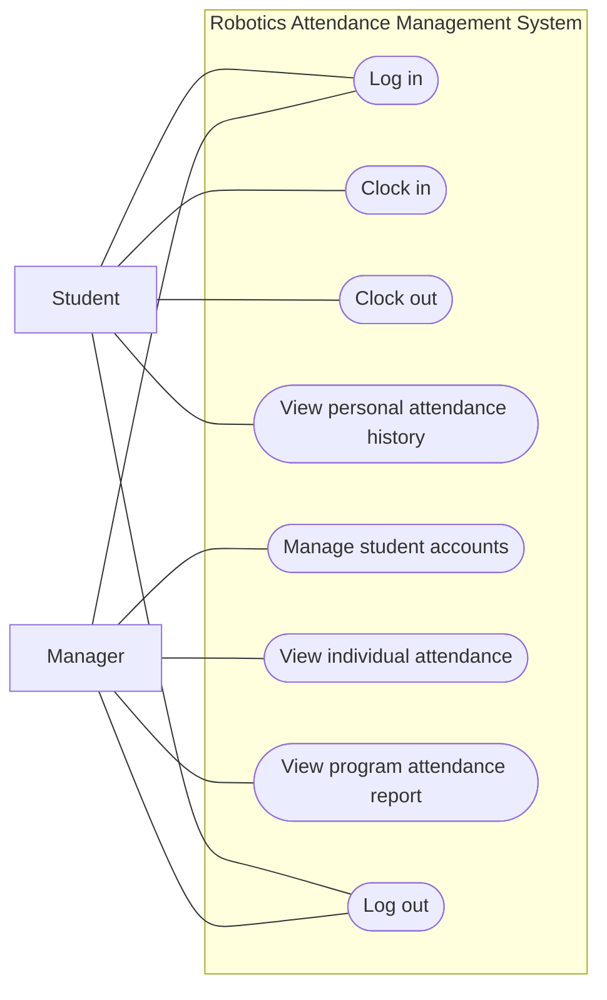
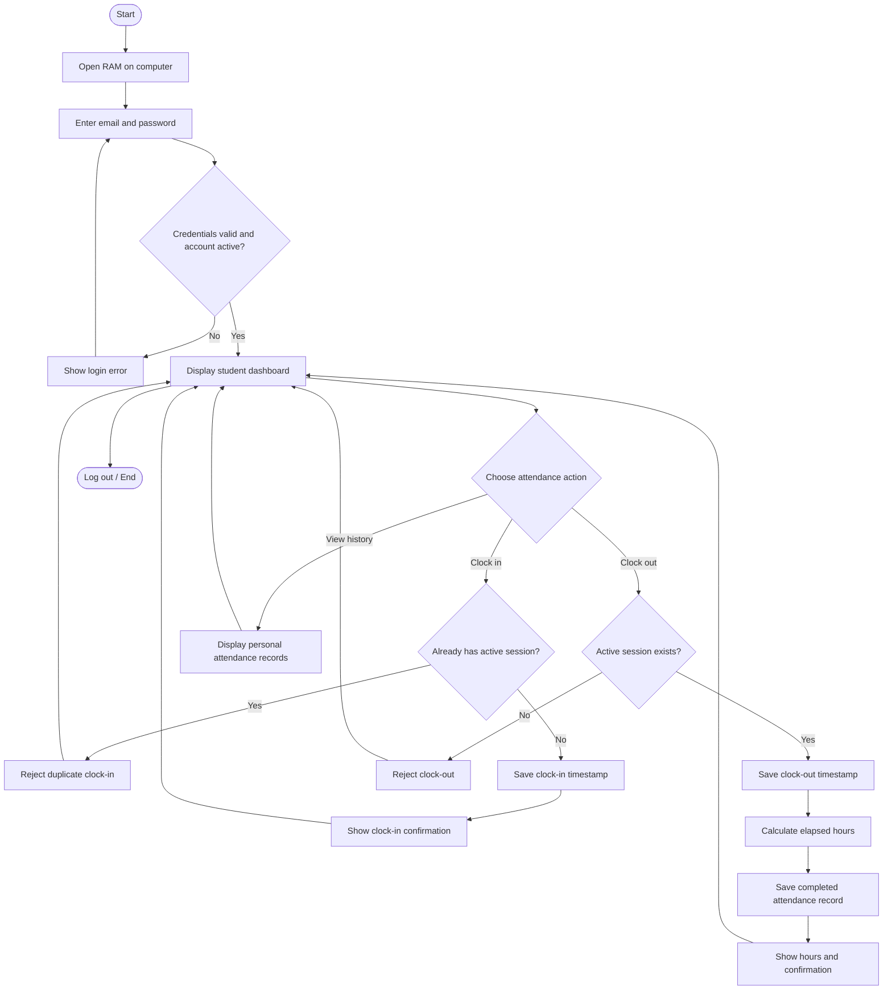
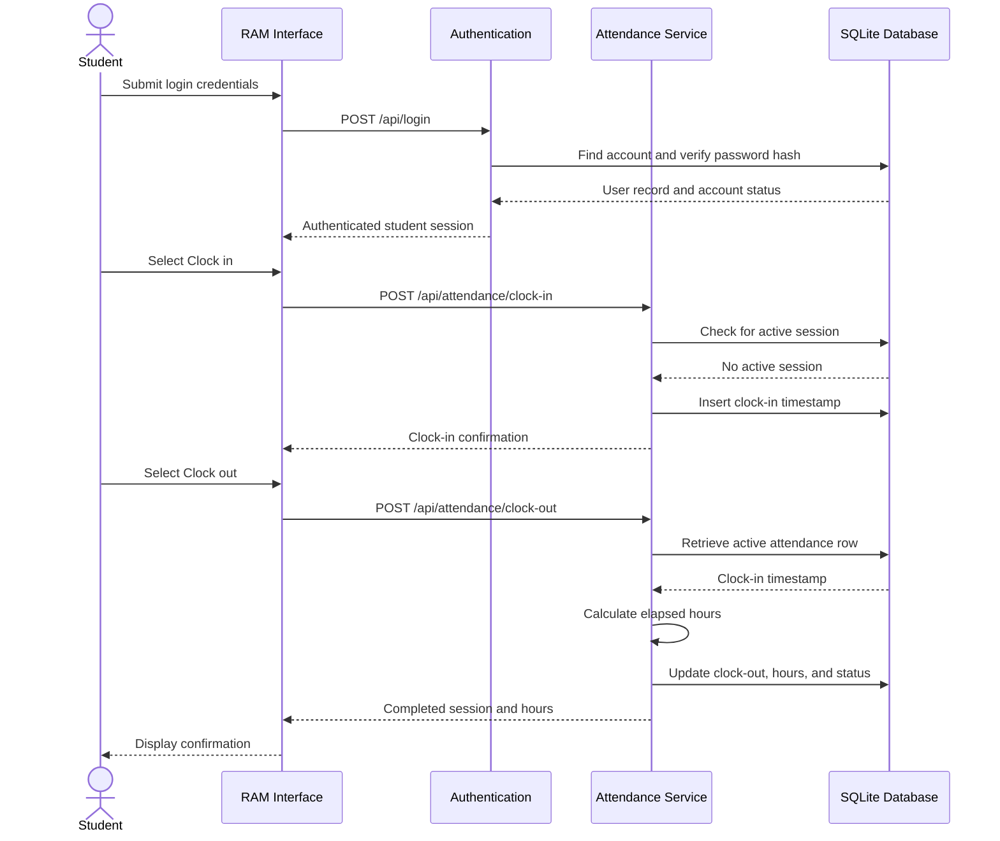
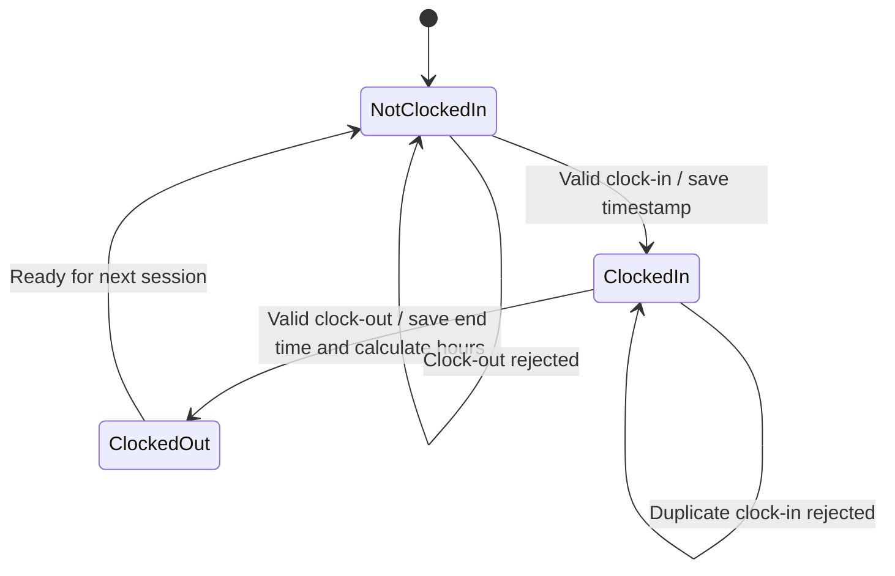
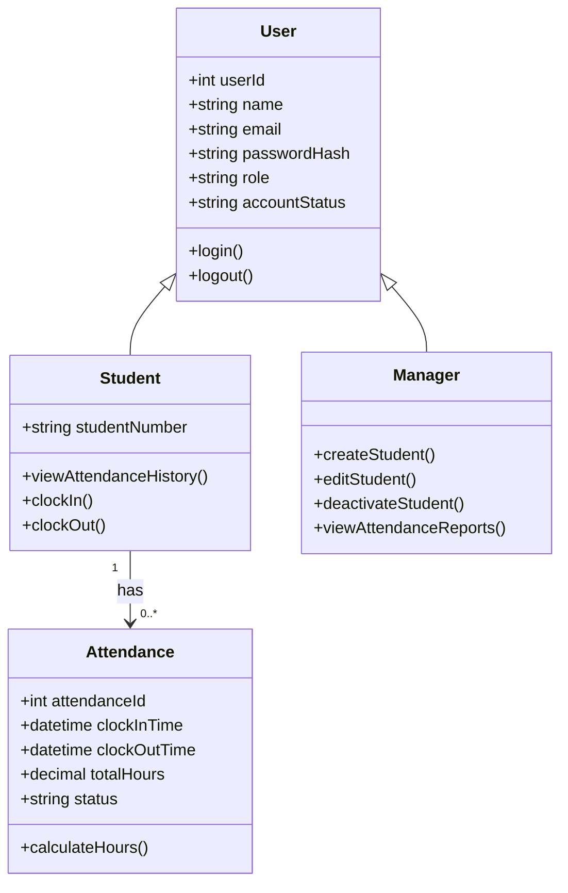
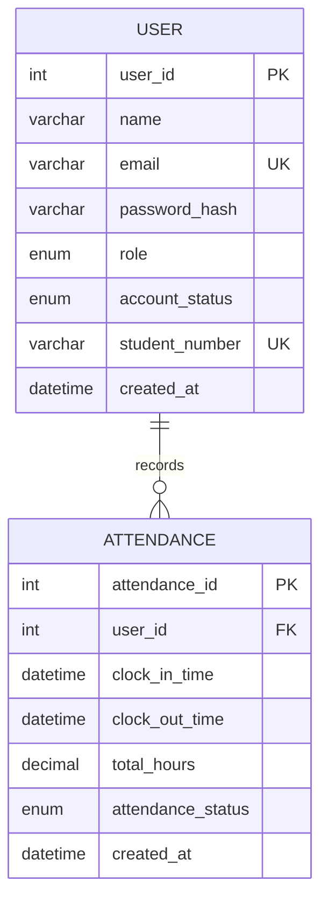
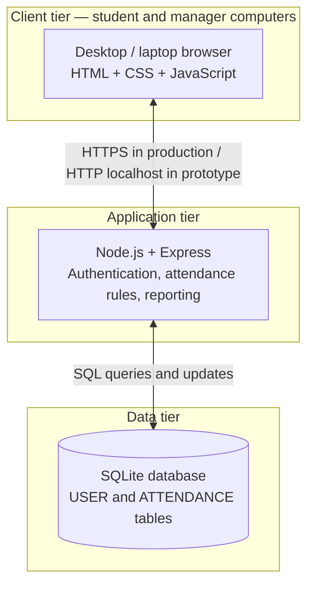
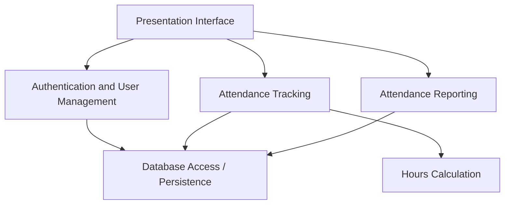

# RAM presentation diagram source

These Mermaid diagrams are editable source. In VS Code, open this Markdown file and use a Mermaid-compatible Markdown preview extension, or paste an individual diagram into a Mermaid renderer and export SVG/PNG for slides. Verify labels and layout after export.

## Figure 1. System context diagram


## Figure 2. Use case diagram


## Figure 3. Student attendance activity diagram


## Figure 4. Clock-in / clock-out sequence diagram


## Figure 5. Attendance state machine


## Figure 6. UML class diagram


## Figure 7. Logical entity relationship diagram


## Figure 8. Three-tier deployment diagram


## Figure 9. Component / module diagram


## Figure 10. CRUD matrix
| Module | USER | ATTENDANCE |
|---|---|---|
| Authentication | R | — |
| User Management | C / R / U | — |
| Attendance Tracking | R | C / R / U |
| Hours Calculation | — | R / U |
| Attendance Reporting | R | R |
| Database Access | Supports authorized operations for the modules above; not an independent business CRUD actor | Supports authorized operations for the modules above |

Legend: C = Create, R = Read, U = Update, D = Delete. Normal manager workflow deactivates accounts rather than hard-deleting users so attendance history is retained.

## Figure 11. Requirements-to-test traceability
| Requirement | Demonstration / acceptance test |
|---|---|
| FR-01 Student login | Valid student can log in; invalid credentials are rejected |
| FR-02 Student clock-in | One active session is created; a second clock-in is rejected |
| FR-03 Clock-out and hours | Active session is closed and elapsed hours are saved |
| FR-04 Attendance history | Student sees only their own attendance records |
| FR-05 Manager account and attendance management | Manager can create/edit/deactivate students and view reports; student cannot access manager endpoints |
```

## Presentation note
Use the context, activity, sequence, state, class, ERD, and deployment diagrams as the core modeling visuals. The module diagram and CRUD/traceability matrices are supporting visuals. Keep text large enough to read from the back of the classroom.
